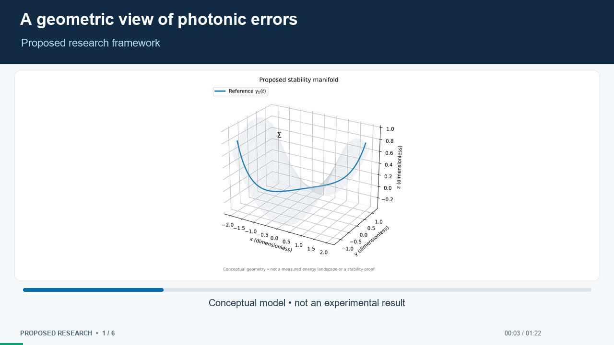

# SEFI Manuscripts

## Featured photonics research

- [Coherent Saddle Encoding and Displacement Recovery: Residual-State Criteria and Timing Limits](https://github.com/JasonSEFIDEFI/SEFI-Manuscripts/blob/cfb09bd14cdd97e31185a3328c46174ccb279b31/Conjugate_Phase_Geometry_AIP_Advances.pdf) — latest consolidated manuscript package, posted November 26, 2026. Prepared as a proposed editorial replacement. [Status and reproducibility](https://github.com/JasonSEFIDEFI/SEFI-Manuscripts/blob/cfb09bd14cdd97e31185a3328c46174ccb279b31/README.txt) · [Verification record](https://github.com/JasonSEFIDEFI/SEFI-Manuscripts/blob/cfb09bd14cdd97e31185a3328c46174ccb279b31/verification.json).
- [SEFI Photonics Workbench](https://github.com/JasonSEFIDEFI/SEFI_QEC_Stack/tree/research/photonic-workbench) — locally runnable dual-rail optical simulator and matched controls.
- [Earlier saddle-coordinate rough draft](https://github.com/JasonSEFIDEFI/SEFI-Manuscripts/tree/research/saddle-manuscript/saddle-quantum-recovery-draft) — retained for provenance.

The latest manuscript reports mathematical and computational results for specified channels. Its optical mapping is a proposal. Matched controls support established subsystem protection without demonstrating an advantage from saddle curvature.

## Featured research videos

### Watch on YouTube

- [Geometric Photonic Quantum Error Correction — narrated abstract](https://youtu.be/ICITJzIhq30)
- [Single Entity Field Interpretation — graphical abstract](https://youtu.be/OifuoTEW7PI)
- [Unified Geometric Field Theory — research video abstract](https://youtu.be/j3l01r9OOj8)

**[Watch or download all three graphical abstracts](https://github.com/JasonSEFIDEFI/SEFI-Manuscripts/tree/main/media/video-abstracts)** — narrated photonic error-correction proposal, Single Entity Field Interpretation graphical abstract, and unified geometric field research overview. Independent research proposals and illustrative models; not accepted publications or experimental confirmations.

## Overview  
This repository contains the formal manuscripts, LaTeX sources, and canonical layers of the SEFI geometric field framework.  
SEFI, DEFI, and GWFM together form a unified geometric interpretation of field behavior, worldline structure, and stability-driven physical architecture.

The repository is organized to reflect the structure of the SEFI canon and its associated manuscripts.

---

## Canon Structure  
### **FIELD ORIGIN**  
Foundational geometric constraints establishing the origin conditions of fields.

### **FIELD AUTHORSHIP**  
Rules governing how fields generate, propagate, and maintain identity.

### **FIELD SOVEREIGNTY**  
Stability principles determining how fields preserve autonomy and resist collapse.

### **WARP:EXPRESSION**  
Geometric warp behavior and its consequences for field encoding and transformation.

---

## Manuscripts  
### **GWFM — Geometric Worldline Field Model**  
Final submitted manuscript (August 28, 2026).  
Includes PDF and full LaTeX source.

### **SEFI — Single Entity Field Interpretation**  
Primary manuscript establishing the SEFI framework.

### **DEFI — Dynamic Entity Field Integration**  
Companion manuscript, introduced in *Unified Geometric Field Theory from Worldline and Identity-Space Invariants*, extending SEFI/GWFM into a single unifying transformation operator.

### **Warp-SEFI**  
Displacement-based warp-field model applying SEFI/DEFI/GWFM identity-space formalism to a conceptual capsule-geometry vehicle.
- `warp-sefi/warp-sefi.tex` — early conceptual essay, *WARP:SEFI: Geometric Warp Theory for Identity-Preserving Transformation*.
- `warp-sefi/aip-advances-submission/` — the formal submission manuscript, *Displacement-Engineered Warp Fields: Tic-Tac Geometry, Stability Surfaces, and Identity-Space Confinement*, prepared for AIP Advances.

### **Photonic QEC**  
Historical geometric photonic recovery proposals and submission material.
- `warp-sefi/photonic-qec/photonic-qec.tex` — early draft, text only.
- `photonic-qec-full/` — the complete manuscript with all figures and submission package (cover letter, alt text), *Geometric Photonic Quantum Error Correction via SEFI, GWFM, and DEFI* (**ADV26-AR-04574**). `named-figures/` holds descriptively-named duplicates of the same figures for display purposes.

---

## Repository Layout  
- `canon/` — Foundational SEFI Canon layer documents (Field Origin, Field Authorship, Field Sovereignty, Warp:Expression).
- `sefi/` — Core SEFI manuscript sources.
- `sefi-dna/` — SEFI DNA / extended identity-layer manuscripts.
- `sefi-space/` — SEFI Space identity-geometry manuscript.
- `gwfm/` — Geometric Worldline Field Model manuscript.
- `unified/` — Unified Geometric Field Theory manuscript (SEFI + DEFI + GWFM), submitted to *Journal of Mathematical Physics*. Includes `unifiying_with_figures.pdf`, a figure-embedded rendition, and `Highlight.jpg`, its graphical summary figure.
- `warp-sefi/` — Warp-field manuscript and the draft photonic QEC manuscript derived from SEFI/GWFM/DEFI.
- `photonic-qec-full/` — Complete photonic QEC manuscript, figures, and submission package.

## Research synchronization - October 18, 2026

- [Manuscript archive and author-review drafts](https://github.com/JasonSEFIDEFI/SEFI-Manuscripts/blob/main/RESEARCH-UPDATE-2026-10-18.md).
- [New simulations, assumptions, and reproducible calculations](https://github.com/JasonSEFIDEFI/SEFI-PY/tree/main/research/2026-10-18).
- [Book manuscripts and early source material](https://github.com/JasonSEFIDEFI/Publishing-V-Drive-Content).

These are research drafts and computational studies, not confirmations of new physics, a working propulsion engine, journal acceptance, or a doctoral award. Prior versions and submission history remain distinct. Existing draft pull requests are retained for review.
