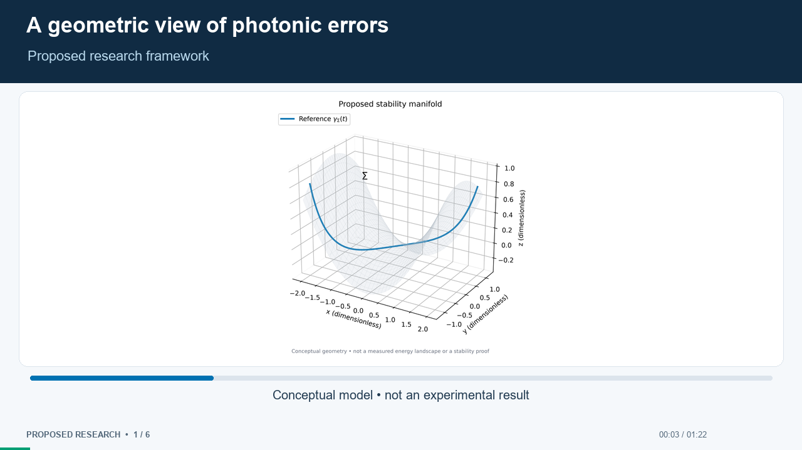
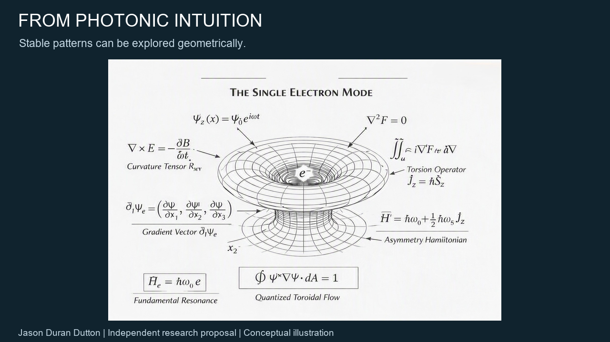
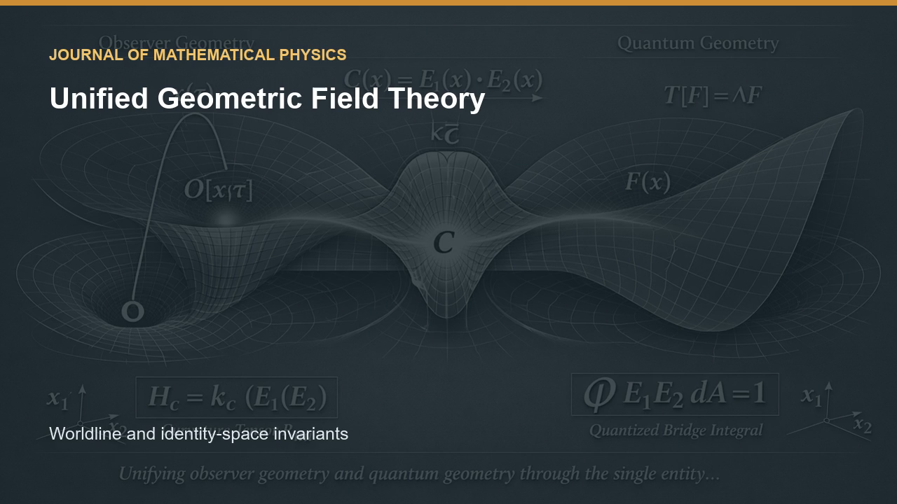

# Research video abstracts

Three separate visual introductions to Jason Duran Dutton's independent research. These videos present proposed interpretations and illustrative mathematics. They do not establish experimental validation, accepted journal publication, or journal endorsement. Any journal name in the older unified-field video identifies its submission context only.

## Geometric Photonic Quantum Error Correction

[Download or open the narrated video](../../photonic-qec-full/candidate-figures-2026-10-28/graphical%20abstract%20video/narrated%20edit/graphical_abstract_narrated.mp4) — 81.6 seconds, with the author's recorded narration. The prescribed vertical projection restores the toy-model constraint by construction. This is not a demonstration of physical quantum recovery.

[Figures, scripts, subtitles, and numerical data](../../photonic-qec-full/candidate-figures-2026-10-28/)

## Single Entity Field Interpretation

[Download or open the graphical abstract](Graphical_Abstract_SEFI_rebuilt.mp4) — 20 seconds, silent. Rebuilt from the four original illustration sources after the original video failed a media-index check. This is a separately named reconstruction, not a repaired bit-for-bit copy. The source illustrations are conceptual; their embedded expressions are not independently validated here.

## Unified Geometric Field Theory

[Download or open the video abstract](JMP_Video_Abstract_Unified_Geometric_Field_Theory.mp4) — 85 seconds, silent. The original video is preserved. [Related manuscript materials](../../unified/).

Videos are available here as files. YouTube links will be added after the public uploads are verified.
